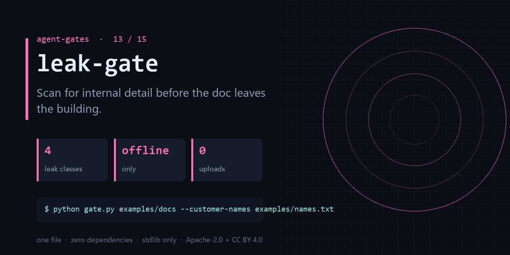

<div align="center">

</div>

<h1 align="center">leak-gate</h1>

<p align="center"><b>Scan for internal detail before the doc leaves the building.</b><br><sub>one file · zero dependencies · stdlib only</sub></p>

<p align="center">  </p>

---

## The failure this catches

- The external proposal still carries a colleague's real email, a customer's full name, an internal IP.
- A screenshot had a ticket number in the corner; you noticed three days after sending it.
- The customer list is spread across a dozen docs and nobody knows which ones went out.

One command, on a file you already have:

```bash
python gate.py examples/docs --customer-names examples/names.txt
```

<details>
<summary><b>Real output</b> — produced by the bundled <code>examples/</code>, not a mock-up</summary>

```text
scanned 1 file(s), 4 finding(s)
warning NET1  examples/docs/plan.md:16 10.12.3.8 — private-range IP address
warning NET2  examples/docs/plan.md:15 corp.internal — internal hostname
warning MAIL1 examples/docs/plan.md:15 zhangsan@corp.internal — email address not on allowlist
warning CUST1 examples/docs/plan.md:15 海红面 — customer name mention
```

</details>

## What it does

- Static rules for internal emails, private IPs, ticket IDs, and your own customer list.
- Allowlist file, so public addresses stop being reported.
- JSON output; runs offline, nothing leaves the machine.

## What it does **not** do

- It is a word-list and regex scanner. Reworded leaks will pass.
- It does not read images or PDFs.
- Zero findings is not a guarantee of safety — it means these rules found nothing.

Being explicit here is cheaper than a wrong expectation later.

## Exit codes

`0` = no findings (or warnings only); `1` = at least one error-level leak.

## Install

```bash
git clone https://github.com/chenhz01/leak-gate
cd leak-gate
python gate.py --help
```

Python 3.9+. Nothing to `pip install` — stdlib only.

## Use it in CI

```yaml
- name: leak-gate
  run: python gate.py examples/docs --customer-names examples/names.txt
```

`action.yml` is included, so you can also reference the repo directly as a composite action.

## 中文速览

**泄露门** — 文件出门之前，先扫一遍内部信息。

- 对外方案里留着同事的真实邮箱、客户全名和内网 IP。
- 截图边角有个工单号，发出去三天后才有人提醒你。
- 客户名单散在十几份文档里，谁也不知道哪份已经被发出去过。

一行命令：`python gate.py examples/docs --customer-names examples/names.txt`

边界：It is a word-list and regex scanner. Reworded leaks will pass.

## The gates

| # | gate | what it stops |
|---|---|---|
| 02 | **[loop-gate](https://github.com/chenhz01/loop-gate)** | Find where your agent looped, before it burns another run |
| 03 | **[permission-gate](https://github.com/chenhz01/permission-gate)** | Score how much more your agent can do than it should |
| 04 | **[context-gate](https://github.com/chenhz01/context-gate)** | Measure what truncation deletes, before the model starts guessing |
| 05 | **[instruction-gate](https://github.com/chenhz01/instruction-gate)** | Two of your instructions contradict each other. This finds them |
| 06 | **[output-gate](https://github.com/chenhz01/output-gate)** | Before AI-written text ships, run the four checks it always fails |
| 07 | **[memory-expiry-gate](https://github.com/chenhz01/memory-expiry-gate)** | Give every memory a TTL, then prove the expiry semantics actually hold |
| 08 | **[drift-gate](https://github.com/chenhz01/drift-gate)** | When embeddings drift, retrieval quietly rots. Fingerprint it |
| 09 | **[price-gate](https://github.com/chenhz01/price-gate)** | Your cost model is only as good as the price table under it |
| 10 | **[complexity-ceiling](https://github.com/chenhz01/complexity-ceiling)** | Per-file complexity budgets that fail the build instead of the reviewer |
| 11 | **[deadcode-gate](https://github.com/chenhz01/deadcode-gate)** | Quantify how much of the repo is dead, instead of guessing |
| 12 | **[docrot-gate](https://github.com/chenhz01/docrot-gate)** | Docs don't die at once. They rot one stale command at a time |
| 13 | **leak-gate** ← you are here | Scan for internal detail before the doc leaves the building |
| 14 | **[backup-gate](https://github.com/chenhz01/backup-gate)** | A backup you have never verified is a rumor |
| 15 | **[trail-gate](https://github.com/chenhz01/trail-gate)** | Hash-chained agent audit trail — and it verifies its own chain |

## License

- Code: **Apache-2.0** — see [LICENSE](LICENSE)
- Docs and example data: **CC BY 4.0** — see [LICENSE-SPEC](LICENSE-SPEC)

Attribution required when you redistribute the documentation; code can be used commercially
without a separate agreement. See [NOTICE](NOTICE).
